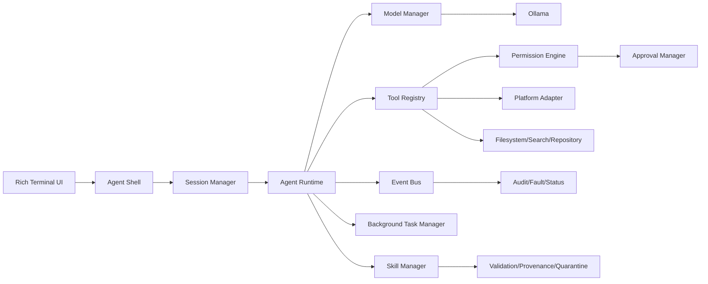

# Architecture Overview

SOL-Lite separates presentation, runtime orchestration, agents, models, tools, permissions, skills, persistence and platform integration.

The runtime is intentionally independent of terminal-specific rendering.

Optional surfaces wired at bootstrap (see [Configuration](configuration.md)):

- **Integrations** — SearXNG search config, Google/Jira catalogs, SOL-Command client from keyring
- **Remote nodes** — `config/remote-nodes.yaml` for lab SSH execute policy
- **Procedures** — checklist state under `data/state/procedures/`; tools gated on current row
- **Voice** — `data/state/voice.json`; `/listen` and `/speak` in the agent shell
- **MCP** — optional extra; see [MCP](../development/mcp.md)
