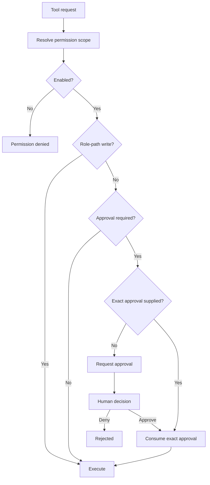

# Permission Architecture

Permission decisions are made before tool execution. Approval records bind exact operation metadata. Workspace writes under the agent's role roots run when `filesystem.write` is enabled (no human click). Paths outside the role still require an exact approval. A session grant, chosen with `s` at the prompt, is checked after the scope is enabled and before an exact approval is consumed for scopes that still require approval. Destructive commands and nested shells never become a session grant.

