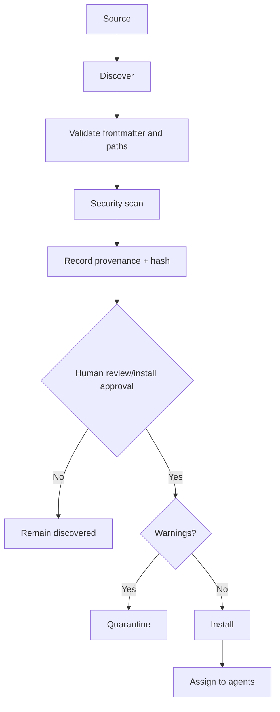

# Skills Architecture

Skill lifecycle:

Skills provide instructions and metadata only. They do not grant permissions or execute scripts during inspection.

## Visual intent routing

`SkillRecord.trigger_phrases` stores phrases parsed from the optional string field `metadata.trigger-phrases` in each manifest. Older records default to an empty list. Separate phrases with `|`; empty phrases are ignored. A non-string trigger field is rejected during inspection.

`prompt_context` exposes the catalogue, then matches manifest phrases against the current task with case-insensitive word boundaries and flexible whitespace. Explicit `$skill-id` mentions also select the full body. Selected bodies bypass the generic four-skill detail cap. Skills with trigger metadata use those phrases rather than incidental description-word matching. Existing specialist groups still run and may provide complementary guidance.

This is lexical selection: quoted or negated phrases can still select a skill. Selection is guidance, not an execution request. Existing workspace precedence, installation policy, agent tool allowlists and approval checks remain authoritative. Global home-directory skill scanning is not introduced.

See [integration details](../integrations/visual-agent-skills.md) and [test evidence](../testing/visual-agent-skills.md).
